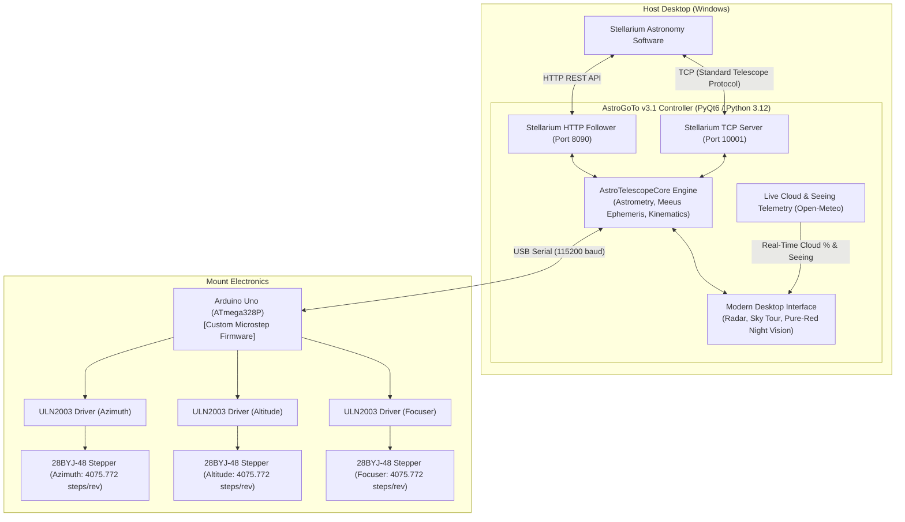

# Custom GoTo Telescope Mount v3.1

> Professional-grade motorized 3-axis Alt-Azimuth telescope GoTo mount and Stellarium desktop integration bridge for 60mm F/2.8 refractors, powered by Arduino Uno, 28BYJ-48 stepper motors, and ULN2003 drivers.

---

## Architecture Overview



---

## Hardware & Wiring

### Arduino Pinout
* **Azimuth Stepper Motor (28BYJ-48 + ULN2003):** Pins `2, 3, 4, 5`
* **Altitude Stepper Motor (28BYJ-48 + ULN2003):** Pins `6, 7, 8, 9`
* **Motorized Focuser Stepper (28BYJ-48 + ULN2003):** Pins `10, 11, 12, 13`
* **Serial Interface:** 115,200 baud, 8-N-1 over standard USB Type-B cable

---

## AstroGoTo v3.1 Features & Enhancements

Version 3.1 delivers advanced astrometric precision, meteorological awareness, and smarter field ergonomics:

* **Live Cloud Cover & Seeing Telemetry (Open-Meteo Integration):**
  * Queries real-time meteorological satellite & atmospheric forecast telemetry asynchronously for your exact observer coordinates.
  * Real-time metrics: **Cloud Cover %**, **Ambient Temperature**, **Relative Humidity %** (for critical dew-point management), **Wind Speed** (mount buffeting risk), and **Visibility Distance**.
  * **Intelligent Atmospheric Transparency Rating:** Classifies sky conditions into `[PRISTINE]`, `[GOOD SEEING]`, `[SCATTERED CLOUDS]`, `[BROKEN CLOUDS]`, or `[OVERCAST]`.
  * **Contextual Target Obscuration Detection:** When local sky is heavily overcast ($\ge 80\%$ clouds), targets in the Sky Tour catalog automatically indicate `OBSCURED (CLOUDY)`, providing instant visual clarity when optical observing is obstructed by overhead clouds.
  * Interactive **Refresh Weather** button in both the main header deck and the Sky Tour window.
* **"Tonight's Best" Interactive Sky Tour & Curated Catalog (Ctrl+T):**
  * Curated database of 34+ premier celestial targets across **Planets & Moon** (with live analytical Meeus and Keplerian planetary ephemerides), **Messier Deep-Sky Objects** (nebulae, clusters, galaxies), and **Showpiece Double Stars & Giants**.
  * **Real-Time Horizon & Visibility Filtering:** Dynamically computes topocentric Altitude and Azimuth every second based on user's geographic coordinates, automatically surfacing objects currently visible above $15^\circ$ elevation and safe from solar keep-out hazard.
  * **Precision Eyepiece Matching (20x, 30x, 40x):**
    * **20x Eyepiece (8.5mm, 2.5° True FOV, 3.0mm exit pupil):** Wide-field framing for sprawling open clusters (Pleiades M45, Beehive M44, Double Cluster NGC 869/884) and the Andromeda Galaxy (M31).
    * **30x Eyepiece (5.67mm, 1.7° True FOV, 2.0mm exit pupil):** Optimal contrast for emission nebulae (Orion Nebula M42, Lagoon M8), globular clusters (Hercules M13, Sagittarius M22), and full-disc lunar views.
    * **40x Eyepiece (4.25mm, 1.25° True FOV, 1.5mm exit pupil):** Maximum resolving power for planetary discs and moons (Jupiter with 4 Galilean moons, Saturn's ring system, Mars), close double stars (Albireo, Castor, Mizar), and lunar crater rims.
  * **One-Click GoTo:** Slew directly to any highlighted object with constant-velocity trajectory, auto-tracking engagement, and real-time arrival chime.
  * **True Independent Peer Window Layering:** Detachable modeless window allows clicking either the main window or the Sky Tour window to pop it to the top of the Z-order instantly.
* **Complete Pure-Red Dark-Sky Night Vision Mode (Ctrl+N):**
  * 100% dark-adapted biological **rhodopsin preservation**: suppresses all blue, green, yellow, and white light across the entire desktop interface.
  * Pitch-black background (`#000000`), deep ruby frames (`#0A0101` / `#2E0505`), and high-contrast crimson typography (`#FF2222` to `#FF4D4D`).
  * **Night-Vision Polar Celestial Radar:** Dynamically renders azimuth spokes, concentric elevation rings, cardinal headings, scope reticles, and Sun danger keep-out zones in dark ruby and crimson (zero white or yellow highlights).
  * Bidirectional synchronization: toggling Night Vision from either window instantly updates both windows.
* **Non-Blocking Acoustic Audio Feedback:**
  * **Ascending Slew Arrival Chime (587 Hz -> 880 Hz):** Pleasant two-tone chime alerts the observer when the telescope has finished slewing and centered on the target, so observers never have to look away from the eyepiece!
  * **Sync Tone (784 Hz):** Crisp single confirmation beep on successful celestial coordinate calibration.
  * **Warning Tone (294 Hz):** Low alert tone if a GoTo slew violates zenith limits or the $15^\circ$ solar keep-out zone.
  * **Emergency Stop Tone (220 Hz):** Urgent double buzz when motion is aborted.
  * Dispatched asynchronously via daemon threads with master **Audio** toggle in the header deck.
* **Atmospheric Refraction Correction:** Incorporates standard Saemundsson (1986) & Bennett (1982) refraction modeling with barometric pressure and temperature scaling, alongside a 5-pass fixed-point numerical inverter (< 0.0001 arcsec error). Objects near the horizon (where refraction can lift starlight by up to $0.5^\circ$) are targeted with sub-arcsecond fidelity.
* **Multi-Rate Astronomical Kinematics:** Selectable tracking rates directly from the UI:
  * **Sidereal Rate ($1.000\times$, $15.041^{\prime\prime}/\text{s}$):** Standard celestial rate for stars, nebulae, and deep sky targets.
  * **Lunar Rate ($0.9635\times$, $14.492^{\prime\prime}/\text{s}$):** Compensates for the Moon's eastward orbital motion ($\approx 0.549^\circ/\text{hr}$), keeping the Moon centered indefinitely in high-power eyepieces.
  * **Solar Rate ($0.9973\times$, $15.000^{\prime\prime}/\text{s}$):** Solar diurnal rate for Sun tracking with certified solar filter.
  * **King Rate:** Refraction-adjusted sidereal tracking rate accounting for the altitude refraction gradient.
* **Cable-Wrap Prevention & Shortest-Path Slew Engine:**
  * Tracks cumulative signed azimuth turns from $0^\circ$ True North.
  * Shortest-path route planning evaluates legal branches within $[-200^\circ, +200^\circ]$, favoring angles that relieve cable twist.
  * Real-time UI cable strain indicator and one-click **Unwind (0°)** button to safely untangle cables.
* **Dynamic Backlash Fast-Takeup:** Automatically accounts for mechanical slop on direction reversals so tracking and meridian crossings never lag.
* **Motorized Auto-Focus Routine (Parabolic V-Curve):** Automated star focus sweep measuring star contrast/FWHM and parking the drawtube at the critical focus zone (CFZ).
* **Predictive Time-of-Flight Intercept:** Fixed-point contraction mapping arrival-time prediction eliminates the classic 15–20 arcminute slew lag on long hops.
* **Dynamic Satellite Tracking:** Continuous velocity-lead feedforward tracking of the ISS and satellites via Stellarium Remote Control API (Port 8090).
* **Enlarged Polar Celestial Radar:** Real-time visual celestial sphere displaying physical telescope pointing, active target reticle, Sun danger keep-out zone, and compass bearings.
* **Standalone Windows Executable:** Single-file `dist/AstroGoTo.exe` with embedded high-resolution black hole icon and assets.

---

## Getting Started

### 1. Arduino Firmware
1. Open [`telescope_firmware.ino`](telescope_firmware.ino) in the Arduino IDE.
2. Install the **AccelStepper** library (via Library Manager).
3. Connect the Arduino Uno over USB, select the COM port, and click **Upload**.

### 2. Running AstroGoTo v3.1
Download the standalone executable from [GitHub Releases](https://github.com/Hitesh070/Custom-GoTo-Telescope/releases), or run from source:
```bash
python telescope_ui_qt.py
```
*(Or double-click `run_app.bat` or launch `dist/AstroGoTo.exe`)*.

To run the bridge in headless mode (console-only with Tkinter fallback via `--tk`):
```bash
python telescope_bridge.py
```
*(Add `--simulate` to test without physical hardware attached; run `--selftest` to execute the automated verification suite).*

### 3. Stellarium Setup
1. Open Stellarium and go to **Configuration (`F2`) -> Plugins -> Telescope Control -> Enable**.
2. Under Telescopes, click **Add (+)**:
   - Telescope controlled by: **External software or a remote computer**
   - Host: `127.0.0.1`
   - Port: `10001`
3. Click **Connect**. Your telescope reticle will appear on screen!
4. Select any celestial object and press **Ctrl + 1** to slew.

---

## Verification Suite
The codebase includes a comprehensive 17-point verification suite:
```bash
python telescope_bridge.py --selftest
```
All 17 astrometric and kinematics tests pass cleanly out of the box.
