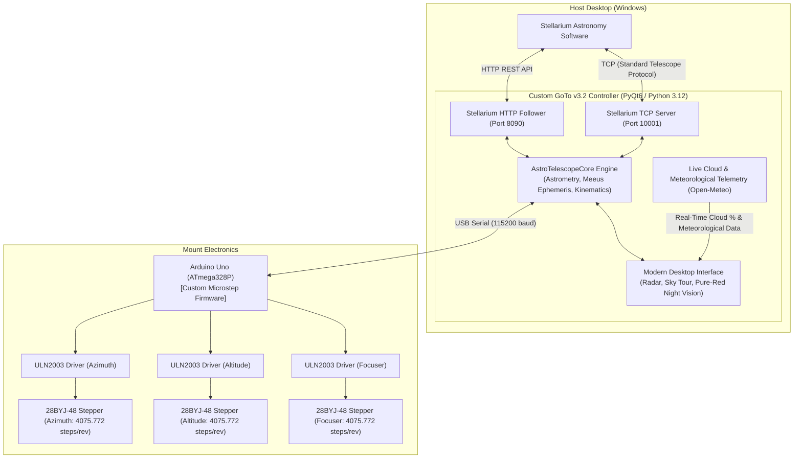

# Custom GoTo Telescope Mount v3.2

> Professional-grade motorized 3-axis Alt-Azimuth telescope GoTo mount and Stellarium desktop integration bridge for 60mm F/2.8 refractors, powered by Arduino Uno, 28BYJ-48 stepper motors, and ULN2003 drivers.

---

## Architecture Overview



---

## Hardware & Wiring

### Arduino Pinout
* **Azimuth Stepper Motor (28BYJ-48 + ULN2003):** Pins `2, 3, 4, 5`
* **Altitude Stepper Motor (28BYJ-48 + ULN2003):** Pins `6, 7, 8, 9`
* **Motorized Focuser Stepper (28BYJ-48 + ULN2003):** Pins `10, 11, 12, 13`
* **Serial Interface:** 115,200 baud, 8-N-1 over standard USB Type-B cable

---

## Custom GoTo v3.2 Features & Enhancements

Version 3.2 delivers refined ergonomics, true night vision preservation, real-time mount tracking, and live weather telemetry:

* **True Pure-Red Dark-Sky Night Vision Mode (Ctrl+N):**
  * 100% dark-adapted rhodopsin preservation across every single element: Data Rate label, Tracking Rate selector, comboboxes, and Activity Console log messages all strictly enforce pure crimson red (`#FF4D4D`, `#AA2222`, `#7A1010`) with zero white or daylight leakage.
  * Instant dynamic re-theming: toggling Night Vision immediately re-renders all existing console history to pure red.
* **Unified Status Deck Indicators:**
  * Clean, consistent pill badges with bold white typography (`#FFFFFF`) on solid status-colored backgrounds:
    * **Arduino:** `ARDUINO: SIMULATED` (Blue `#1E4472`), `ARDUINO: CONNECTED` (Green `#1E7E34`), `ARDUINO: DISCONNECTED` (Red `#8A1B1B`).
    * **Stellarium:** `STELLARIUM: CONNECTED` (Green `#1E7E34`), `STELLARIUM: LISTENING` (Red `#8A1B1B`).
    * **Weather:** `[BADGE % CLOUD | TEMP]` (Grey `#272C36`, matching Settings).
* **Automatic Coordinate & Meteorological Synchronization:**
  * Automatic location sync from Stellarium (Port 8090) triggered instantly whenever Stellarium connects.
  * Live Open-Meteo weather telemetry automatically initializes at application startup.
* **Smart Tracking Display:**
  * Tracking toggle button and telemetry table dynamically display the active rate type (`Tracking: ON (SIDEREAL)`, `Tracking: ON (LUNAR)`, `Tracking: ON (SOLAR)`, `Tracking: ON (KING)`).
* **Tonight's Best Window Enhancements:**
  * **20 Hz High-Speed Mount Readout:** Dedicated 50ms timer delivers real-time `Mount: Az ..., Alt ...` updates in an enlarged 15px bold font.
  * **Clean Atmospheric Metrics Deck:** Direct, structured telemetry row displaying Sky Condition, Seeing Transparency, Temperature, Relative Humidity, Wind Speed, and Visibility without verbose prose.
  * Cleaned category tabs: "Tonight's Visible" filter.
* **Refined Console Deck:** Ergonomically reordered controls: `[Sync Location]  [Clear Console]  [Auto-Scroll]`.
* **Solar Observation Safety Interlock:** High-visibility white text for certified solar filter confirmation and clean angular separation telemetry.
* **Standalone Windows Executable:** Built single-file `dist/AstroGoTo.exe` with black hole application icon.
* **Enlarged Polar Celestial Radar:** Real-time visual celestial sphere displaying physical telescope pointing, active target reticle, Sun danger keep-out zone, and compass bearings.
* **Standalone Windows Executable:** Single-file `dist/AstroGoTo.exe` with embedded high-resolution black hole icon and assets.

---

## Getting Started

### 1. Arduino Firmware
1. Open [`telescope_firmware.ino`](telescope_firmware.ino) in the Arduino IDE.
2. Install the **AccelStepper** library (via Library Manager).
3. Connect the Arduino Uno over USB, select the COM port, and click **Upload**.

### 2. Running AstroGoTo v3.1
Download the standalone executable from [GitHub Releases](https://github.com/Hitesh070/Custom-GoTo-Telescope/releases), or run from source:
```bash
python telescope_ui_qt.py
```
*(Or double-click `run_app.bat` or launch `dist/AstroGoTo.exe`)*.

To run the bridge in headless mode (console-only with Tkinter fallback via `--tk`):
```bash
python telescope_bridge.py
```
*(Add `--simulate` to test without physical hardware attached; run `--selftest` to execute the automated verification suite).*

### 3. Stellarium Setup
1. Open Stellarium and go to **Configuration (`F2`) -> Plugins -> Telescope Control -> Enable**.
2. Under Telescopes, click **Add (+)**:
   - Telescope controlled by: **External software or a remote computer**
   - Host: `127.0.0.1`
   - Port: `10001`
3. Click **Connect**. Your telescope reticle will appear on screen!
4. Select any celestial object and press **Ctrl + 1** to slew.

---

## Verification Suite
The codebase includes a comprehensive 17-point verification suite:
```bash
python telescope_bridge.py --selftest
```
All 17 astrometric and kinematics tests pass cleanly out of the box.
