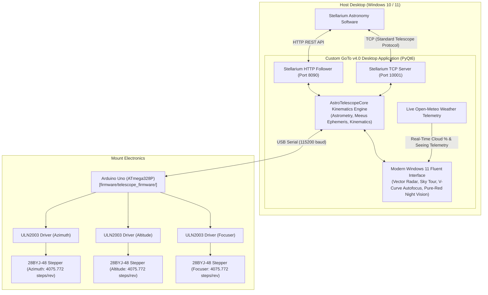

# Custom GoTo Telescope Mount v4.0

<p align="center">
  
</p>

<p align="center">
  <b>Professional 3-Axis Motorized Alt-Azimuth GoTo Telescope Controller & Stellarium Bridge</b><br>
  <i>Engineered for 60mm F/2.8 refractors, Arduino Uno, 28BYJ-48 steppers, and ULN2003 drivers.</i>
</p>

<p align="center">
  
  
  
  
  
  
</p>

---

## Architecture Overview



---

## Key Features in Release v4.0

### Modern Windows 11 Desktop Experience
* **Professional UI Architecture:** Engineered in PyQt6 following Windows 11 design guidelines, decoupling logic into modular packages (`src/core/` and `src/ui/`).
* **High-DPI Scaling & Taskbar Integration:** Explicit Windows `AppUserModelID` (`astro.goto.telescope.controller.v3`) for crisp taskbar branding.
* **Dual Theme Engine:**
  * **Obsidian Dark Theme:** Deep space backdrop (`#0d1117`), elevated card panels (`#161b22`), and celestial cyan accents (`#38bdf8`).
  * **Astronomer Pure-Red Night Vision:** True OLED black (`#000000`) and pure crimson (`#ff0033`) eliminating daylight leakage to preserve retinal rhodopsin during dark-sky sessions.

### Precision Astrometry & Kinematics
* **High-Speed Telemetry Streaming:** 20–25 Hz real-time mount updates with tabular monospace typography that prevents number jitter.
* **Vector Polar Sky Radar:** Hardware-accelerated `QPainter` celestial projection displaying mount reticle, target reticle, altitude concentric rings, cardinal points, and solar keep-out zone.
* **Tonight's Best Celestial Tour:** Curated deep-sky and planetary target catalog with real-time altitude visibility filtering, ephemeris calculations, and 1-click slew.
* **Motorized AutoFocus & V-Curve:** Step jogger, absolute position GoTo, zero position calibration, and automated parabolic V-curve focus routine.
* **Multi-Rate Tracking Engine:** Multi-rate tracking (Sidereal 15.041"/s, Lunar 14.685"/s, Solar 15.000"/s, King refraction-corrected) and continuous satellite LEO tracking.
* **Safety Protocols:**
  * Active solar separation barrier preventing slews within unsafe proximity to the Sun without physical filter verification.
  * Cable anti-wrap tracking with 1-click unwind routine.

### Hardware Diagnostics
* **Bidirectional Serial Monitor:** Live packet inspector with ASCII/HEX modes and custom command transmitter.
* **Meteorological Telemetry:** Live Open-Meteo cloud cover %, temperature, humidity, wind speed, and seeing transparency.

---

## Repository Structure

```text
Custom-GoTo-Telescope/
├── assets/                     # Application branding & Black Hole icons
│   ├── black_hole_icon.ico
│   └── black_hole_icon.png
├── docs/                       # Comprehensive documentation & build guide
│   └── GoTo_Telescope_v2.1_Build_Guide.docx
├── firmware/                   # Arduino Uno ATmega328P firmware (Arduino sketchbook format)
│   └── telescope_firmware/
│       └── telescope_firmware.ino
├── scripts/                    # Utility & icon generation scripts
│   └── generate_icon.py
├── src/                        # Modular application codebase (v4.0)
│   ├── core/                   # Astrometry, catalog & weather services
│   │   ├── astrometry.py       # Ephemeris, coordinates & J2000 precession
│   │   ├── catalog.py          # Curated Tonight's Best celestial database
│   │   └── weather_service.py  # Open-Meteo meteorological service
│   └── ui/                     # Themes, widgets, dialogs, main window
│       ├── theme.py            # Windows 11 Obsidian & Pure-Red Night Vision stylesheets
│       ├── app.py              # Application bootstrapper & DPI configuration
│       ├── main_window.py      # Primary window shell & 20Hz telemetry HUD
│       ├── widgets/            # Polar sky radar & parabolic focus curve
│       └── dialogs/            # GoTo, Tour, AutoFocus, Serial Monitor, Settings, Help
├── tests/                      # Automated unit & integration verification suite
│   ├── test_serial_monitor_and_optics.py
│   ├── test_tonight_best_alignment.py
│   ├── test_global_shortcuts.py
│   └── test_verification_suite.py
├── .gitignore                  # Git ignore rules
├── build_exe.py                # Standalone Windows PyInstaller packaging script
├── README.md                   # Project documentation & architecture
├── requirements.txt            # Python dependencies
├── run_app.bat                 # 1-click Windows desktop launcher
├── telescope_bridge.py         # Hardware communications & Stellarium bridge engine
├── telescope_config.example.json # Configuration template
└── telescope_ui_qt.py          # Unified desktop UI entrypoint
```

---

## Hardware & Electronics

### Arduino Uno Pinout

| Axis / Function | Motor / Device | Driver Board | Arduino Pins |
| :--- | :--- | :--- | :--- |
| **Azimuth (RA)** | 28BYJ-48 Stepper | ULN2003 Driver | Pins `2, 3, 4, 5` |
| **Altitude (Dec)** | 28BYJ-48 Stepper | ULN2003 Driver | Pins `6, 7, 8, 9` |
| **Motorized Focuser** | 28BYJ-48 Stepper | ULN2003 Driver | Pins `10, 11, 12, 13` |
| **Serial Communication** | Host PC USB | Internal FTDI/CH340 | `115200 baud, 8-N-1` |

> [!IMPORTANT]
> **Power Supply Requirement:** Never power the ULN2003 driver boards directly from the Arduino's 5V pin. Connect a dedicated external 5V (2A or higher) power supply to the ULN2003 power rails. Tie external Ground and Arduino Ground together.

---

## Keyboard Shortcuts

> [!NOTE]
> **Application-Wide Scope:** All shortcuts are monitored via an application-level event filter and work seamlessly across **any open window or dialog** in the application (even while examining Tonight's Best, GoTo coordinates, Serial Monitor, Settings, or Help).

| Shortcut | Action | Scope / Context | Description |
| :--- | :--- | :--- | :--- |
| `Alt + N` / `Ctrl + N` | **Toggle Night Vision** | Global (Any Window) | Instantly switch between Obsidian Dark and Pure-Red OLED Night Vision across all windows |
| `Escape` | **Emergency Stop** | Global (Any Window) | Instantly aborts all motor slews, jogs, and tracking routines |
| `Space` | **Emergency Stop** | Non-text entry | Immediately halts all motors (safe spacebar: passes spaces normally when typing in text fields) |
| `Up` / `Down` Arrow | **Altitude Jog** | Global (Any Window) | Step altitude axis up (+) or down (-) at selected jog speed |
| `Left` / `Right` Arrow | **Azimuth Jog** | Global (Any Window) | Step azimuth axis left (CCW) or right (CW) at selected jog speed |
| `Ctrl + 1` | **Speed: Fine** | Global (Any Window) | Set jog resolution to Fine (0.05° per step) |
| `Ctrl + 2` | **Speed: Medium** | Global (Any Window) | Set jog resolution to Medium (0.50° per step) |
| `Ctrl + 3` | **Speed: Coarse** | Global (Any Window) | Set jog resolution to Coarse (3.00° per step) |
| `Ctrl + T` | **Tonight's Best** | Global (Any Window) | Open or bring to front the curated Tonight's Best sky tour |
| `Ctrl + G` | **GoTo Coordinates** | Global (Any Window) | Open or bring to front the manual GoTo target & catalog dialog |
| `Ctrl + M` | **Serial Monitor** | Global (Any Window) | Open or bring to front the raw bidirectional ASCII/HEX serial terminal |
| `Ctrl + S` | **Settings** | Global (Any Window) | Open the kinematics, observer GPS site, and bridge port configuration |
| `F1` / `Ctrl + H` | **Help & Manual** | Global (Any Window) | Open the technical user manual and electronics documentation |
| `Ctrl + U` | **Unwind Cable** | Global (Any Window) | Slew Azimuth back to 0° True North to untangle motor and camera cables |

---

## Getting Started

### 1. Upload Arduino Firmware
1. Open [`firmware/telescope_firmware/telescope_firmware.ino`](firmware/telescope_firmware/telescope_firmware.ino) in the Arduino IDE.
2. Install the **AccelStepper** library (via **Tools -> Manage Libraries**).
3. Connect the Arduino Uno over USB, select the board and COM port, and click **Upload**.

### 2. Launch the Desktop Application
Download the standalone executable from [GitHub Releases](https://github.com/Hitesh070/Custom-GoTo-Telescope/releases), or run from source:
```bash
pip install -r requirements.txt
python telescope_ui_qt.py
```
*(Or double-click `run_app.bat` or launch `dist/CustomGoTo.exe`)*.

Add `--simulate` to test the mount with virtual motors and simulated telemetry without physical hardware:
```bash
python telescope_ui_qt.py --simulate
```

### 3. Stellarium Setup
1. In Stellarium, open **Configuration (`F2`) -> Plugins -> Telescope Control -> Enable**.
2. Under Telescopes, click **Add (+)**:
   - Telescope controlled by: **External software or a remote computer**
   - Host: `127.0.0.1`
   - Port: `10001`
3. Click **Connect**. The telescope reticle will appear on screen.
4. Select any celestial object and press **Ctrl + 1** to slew.

---

## Building Standalone Windows Executable (.exe)

Compile the single-file Windows executable with embedded icon and assets:
```bash
python build_exe.py
```
The resulting binary is created at:
```text
dist/CustomGoTo.exe
```

---

## Automated Verification Suite

Run the full automated test suite covering astrometry, night vision propagation, Stellarium synchronization, and kinematics:
```bash
python -m unittest discover tests
```
All unit tests pass cleanly out of the box.
