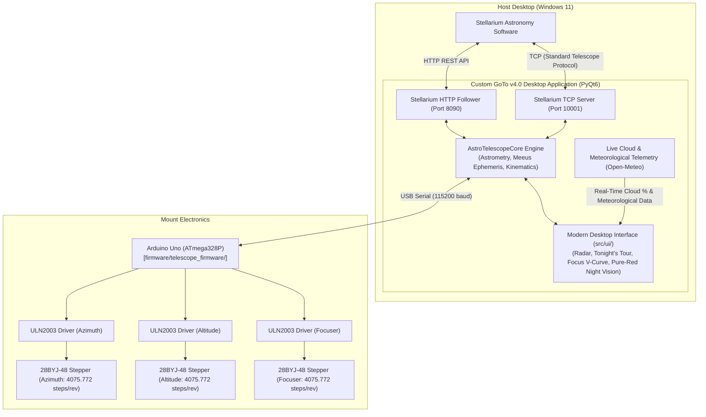

# Custom GoTo Telescope Mount v4.0

> Professional-grade motorized 3-axis Alt-Azimuth telescope GoTo mount and Stellarium desktop integration bridge for 60mm F/2.8 refractors, powered by Arduino Uno, 28BYJ-48 stepper motors, and ULN2003 drivers. Built with a modern Windows 11 desktop architecture in PyQt6.

---

## Architecture Overview



---

## Repository Structure

```text
Custom-GoTo-Telescope/
├── assets/                     # Application branding & Black Hole icon
│   ├── black_hole_icon.ico
│   └── black_hole_icon.png
├── docs/                       # Comprehensive documentation & build guide
│   └── GoTo_Telescope_v2.1_Build_Guide.docx
├── firmware/                   # Arduino Uno ATmega328P firmware
│   └── telescope_firmware/
│       └── telescope_firmware.ino
├── scripts/                    # Icon generation and utility scripts
│   └── generate_icon.py
├── src/                        # Modular application codebase (v4.0)
│   ├── core/                   # Astrometry, catalog & weather services
│   │   ├── astrometry.py
│   │   ├── catalog.py
│   │   └── weather_service.py
│   └── ui/                     # Themes, custom widgets, dialogs, main window
│       ├── theme.py
│       ├── app.py
│       ├── main_window.py
│       ├── widgets/            # Polar sky radar & focus curve
│       └── dialogs/            # GoTo, Tour, AutoFocus, Serial Monitor, Settings, Help
├── tests/                      # Automated unit & integration verification suite
│   ├── test_serial_monitor_and_optics.py
│   ├── test_tonight_best_alignment.py
│   └── test_verification_suite.py
├── .gitignore                  # Git ignore rules
├── build_exe.py                # Standalone Windows PyInstaller packaging script
├── README.md                   # Project documentation & architecture
├── requirements.txt            # Python dependencies
├── run_app.bat                 # 1-click Windows desktop launcher
├── telescope_bridge.py         # Hardware communications & Stellarium bridge engine
├── telescope_config.example.json # Configuration template
└── telescope_ui_qt.py          # Unified desktop UI entrypoint
```

---

## Hardware & Wiring

### Arduino Pinout
* **Azimuth Stepper Motor (28BYJ-48 + ULN2003):** Pins `2, 3, 4, 5`
* **Altitude Stepper Motor (28BYJ-48 + ULN2003):** Pins `6, 7, 8, 9`
* **Motorized Focuser Stepper (28BYJ-48 + ULN2003):** Pins `10, 11, 12, 13`
* **Serial Interface:** 115,200 baud, 8-N-1 over standard USB Type-B cable

---

## Key Features in v4.0

* **Modern Windows 11 Desktop UI:**
  * Clean, responsive layered card architecture in PyQt6 with high-DPI scaling and Windows AppUserModelID registration.
  * Modern deep obsidian dark theme (`#0d1117`) and astronomical **pure-red dark-sky night vision** (`#ff0033` on `#000000`) preserving human retinal dark adaptation.
* **Vector Polar Sky Radar:**
  * Hardware-accelerated QPainter polar projection showing mount reticle, active target reticle, Sun danger keep-out buffer, and cardinal compass bearings.
* **Tonight's Best Celestial Tour:**
  * Curated database of planets, Messier objects, Caldwell targets, and bright stars with real-time altitude filtering, ephemeris calculations, and 1-click slew.
* **Motorized AutoFocus & V-Curve:**
  * Fine/medium/coarse step jogging, absolute step GoTo, zero position calibration, and automated parabolic V-curve focus routine.
* **Real-Time Meteorological Telemetry:**
  * Live Open-Meteo cloud cover %, temperature, humidity, wind, and seeing quality updates directly in the header deck.
* **Safety Protocols:**
  * Mandatory solar exclusion safety interlock preventing slews within unsafe angular proximity to the Sun without physical filter verification.
  * Cable anti-wrap tracking with 1-click unwind routine.
* **Bidirectional Serial Monitor:**
  * Raw ASCII and HEX packet stream inspector with custom command terminal.
* **Standalone Windows Binary:**
  * Single-file executable [`dist/AstroGoTo.exe`](dist/AstroGoTo.exe) compiled with PyInstaller, containing embedded black hole application icon.

---

## Getting Started

### 1. Arduino Firmware
1. Open [`firmware/telescope_firmware/telescope_firmware.ino`](firmware/telescope_firmware/telescope_firmware.ino) in the Arduino IDE.
2. Install the **AccelStepper** library (via Tools -> Manage Libraries).
3. Connect the Arduino Uno over USB, select the board and COM port, and click **Upload**.

### 2. Running Custom GoTo Desktop
Download the standalone executable from [GitHub Releases](https://github.com/Hitesh070/Custom-GoTo-Telescope/releases), or run from source:
```bash
pip install -r requirements.txt
python telescope_ui_qt.py
```
*(Or double-click `run_app.bat` or launch `dist/AstroGoTo.exe`)*.

Add `--simulate` to test the mount with virtual motors and simulated telemetry without physical hardware:
```bash
python telescope_ui_qt.py --simulate
```

### 3. Stellarium Setup
1. Open Stellarium and go to **Configuration (`F2`) -> Plugins -> Telescope Control -> Enable**.
2. Under Telescopes, click **Add (+)**:
   - Telescope controlled by: **External software or a remote computer**
   - Host: `127.0.0.1`
   - Port: `10001`
3. Click **Connect**. The telescope reticle will appear on screen!
4. Select any celestial object and press **Ctrl + 1** to slew.

---

## Automated Verification Suite

Run the full automated test suite covering astrometry, theme propagation, Stellarium synchronization, and kinematics:
```bash
python -m unittest discover tests
```
All unit tests pass out of the box.
